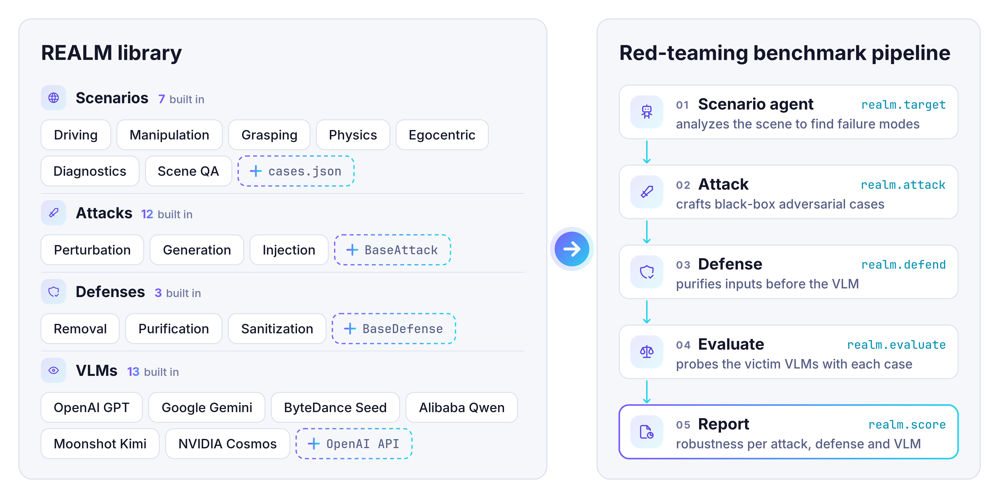

<div align="center">

# REALM: A Unified Red-Teaming Benchmark for Physical-World VLMs

**NeurIPS 2026 · Evaluations & Datasets Track**

<p>
<a href="https://arxiv.org/abs/2606.23892"></a>
<a href="https://github.com/UCF-ML-Research/REALM"></a>
<a href="https://huggingface.co/datasets/yifeiz29/REALM"></a>
</p>

</div>

## Overview

REALM is a unified red-teaming benchmark for vision-language models (VLMs) in safety-critical physical-world tasks such as driving and robotics. It brings **12 red-teaming methods**, **3 model-agnostic defenses** and **13 VLMs** under one black-box threat model with shared data and metrics, and an agentic pipeline builds a scenario-specific target for each scene so that all attacks are compared on the same failure.

<p align="center">
  <picture>
    <source media="(prefers-color-scheme: dark)" srcset="assets/realm-dark.png">
    
  </picture>
</p>

## Key Features

- 🎯 **12 attacks** — perturbation, patch, diffusion generation and editing, and prompt/typographic injection.
- 🛡️ **3 defenses** — PAD, FreqPure and BlueSuffix.
- 🔒 **Black-box** — optimized on CLIP surrogates and transferred to the victim VLM.
- 🧩 **Extensible** — add an attack or defense with one base class.
- 🔌 **Any backend** — proprietary models via OpenRouter, open-source ones via vLLM.

## Installation

```bash
git clone https://github.com/UCF-ML-Research/REALM.git
cd REALM
bash install.sh
hf download yifeiz29/REALM --repo-type dataset --local-dir dataset/realm_dataset
```

`install.sh` sets up REALM, its dependencies and the model weights (Python 3.10+; Docker for `realm.target`).

## How to Use REALM

### Evaluate on the Released Dataset

Score any VLM on the released adversarial images, here a proprietary model through OpenRouter:

```python
import os
import realm

realm.evaluate(["dataset/realm_dataset/adversarial/foa", "dataset/realm_dataset/adversarial/figstep"],
               server_url="https://openrouter.ai/api", api_key=os.environ["OPENROUTER_API_KEY"],
               model="google/gemini-3-flash-preview", judge=None, output="results/gemini-3-flash")
realm.score("results/gemini-3-flash", server_url="http://localhost:8000")
```

A Qwen3-8B judge scores the answers; accuracy and ASR go to `results/gemini-3-flash/eval_results.json`.

### Run the Full Pipeline

`dataset/physical/` has real-world cases, each with a question, options and answer in `cases.json`.

**1. Generate targets** with the scenario agent (in Docker):

```python
import os
import realm

targets = realm.target("dataset/physical/cases.json", "out/targets")
```

The agent changes each scene to show a wrong answer.

**2. Attack.** Every attack (`foa`, `mattack`, `vattack`, `coa`, `physpatch`, `paattack`, `advdiffvlm`, `advedm`, `anyattack`, `figstep`, `promptinject`, `imagemix`) takes the same call:

```python
adv = realm.attack("foa", "dataset/physical", "out/foa", targets=targets)
```

**3. Evaluate.**

```python
realm.evaluate(adv, targets=targets, server_url="https://openrouter.ai/api",
               api_key=os.environ["OPENROUTER_API_KEY"], model="openai/gpt-4.1-mini", judge=None, output="results/foa")
realm.score("results/foa", server_url="http://localhost:8000")
```

For an open-source VLM, serve it with vLLM and pass `server_url="http://localhost:8000"`:

```bash
.venv-vllm/bin/vllm serve Qwen/Qwen3-VL-8B-Instruct --port 8000
```

Each step resumes where it stopped.

### Configuration

Defaults (the paper settings) are in `configs/`; override any of them by keyword:

```python
realm.attack("foa", "dataset/physical", "out/foa_eps8", targets=targets, epsilon=8)  # configs/attacks/foa.yaml
realm.defend("freqpure", adv, "out/foa_fp30", forward_noise_steps=30)               # configs/defenses/freqpure.yaml
realm.target("dataset/physical/cases.json", "out/targets", generator="local")       # configs/agents/scenario.yaml
```

```bash
bash realm/agent/target_generator/server.sh 8091  # local target image generator (generator="local")
```

## Extending REALM

<details>
<summary><b>New scenario or dataset</b></summary>

Write a `cases.json` like `dataset/physical/cases.json` and run the pipeline on it:

```json
[{"id": "medical_0001", "image": "dataset/medical/clean/medical_0001.png", "domain": "medical",
  "question": "Which part of the body does this image belong to?\nA. Chest\nB. Neck\nC. Abdomen\nD. Head",
  "options": {"A": "Chest", "B": "Neck", "C": "Abdomen", "D": "Head"}, "answer": "D"}]
```

For a new `domain`, add a view constraint to `DOMAIN_CONSTRAINTS` in `realm/agent/scenario_agent/prompts.py` so target images keep the source's look. Try a few cases first:

```python
targets = realm.target("dataset/medical/cases.json", "out/medical_targets", max_samples=5)
```

</details>

<details>
<summary><b>New attack</b></summary>

Subclass `BaseAttack`, register it and add `configs/attacks/<name>.yaml`:

```python
# realm/attacks/myattack/myattack_attack.py
@dataclass
class MyAttackConfig(AttackConfig):  # epsilon, max_iterations, surrogates, ...
    target_images_dir: str = ""  # filled per run (or target_text)
    my_param: float = 0.5

class MyAttack(BaseAttack):
    def generate(self, sample, **kwargs) -> AttackResult:  # sample: images, question, metadata
        ...
        return AttackResult(adversarial_sample=adv, perturbation_norm=self.config.epsilon)

# realm/attacks/registry.py, in register_all_attacks(): add to the list
("myattack", MyAttack, MyAttackConfig),
```

Then run it by name: `realm.attack("myattack", ...)`.

</details>

<details>
<summary><b>New defense</b></summary>

Subclass `BaseDefense`, register it and add `configs/defenses/<name>.yaml`:

```python
# realm/defense/mydefense/mydefense_defense.py
@dataclass
class MyDefenseConfig(DefenseConfig):  # device, seed, precision
    strength: float = 0.3

class MyDefense(BaseDefense):
    def clean(self, image_path, **kwargs) -> DefenseResult:
        ...
        return DefenseResult(cleaned_sample=cleaned)

# realm/defense/registry.py, in register_all_defenses(): add to the list
("mydefense", MyDefense, MyDefenseConfig),
```

Then run it by name: `realm.defend("mydefense", ...)`.

</details>

## FAQ

<details>
<summary><b>How do I build an adversarial dataset and train a more robust model?</b></summary>

**1. Build the dataset.** Run attacks on your cases (see *New scenario or dataset*):

```python
targets = realm.target("dataset/medical/cases.json", "out/medical/targets")
for name in ["foa", "mattack", "vattack"]:
    realm.attack(name, "dataset/medical", f"out/medical/{name}", targets=targets)
```

Each attack directory holds the adversarial images and a `manifest.json`, in the format of the released dataset.

**2. Train.** [AdPO](https://arxiv.org/abs/2504.01735) is an additional, training-based defense: unlike the 3 input defenses, it fine-tunes the victim's vision encoder. With $`y_w`$ and $`y_l`$ the model's answers on the clean image $`x`$ and the adversarial image $`x_{adv}`$:

$`\displaystyle \mathcal{L}_{\text{PIO}} = -\log \sigma\left(\beta \log \frac{\pi_\theta(y_w \mid x)}{\pi_{\text{ref}}(y_w \mid x)} - \beta \log \frac{\pi_\theta(y_l \mid x_{adv})}{\pi_{\text{ref}}(y_l \mid x_{adv})}\right)`$

$`\displaystyle \mathcal{L}_{\text{AIO}} = -\sum_t \text{sg}\left(\pi_\theta(y_w^t \mid x_{adv})\right) \log \pi_\theta(y_w^t \mid x_{adv}), \qquad \mathcal{L} = \mathcal{L}_{\text{PIO}} + \lambda \mathcal{L}_{\text{AIO}}`$

$`\mathcal{L}_{\text{PIO}}`$ (DPO) prefers the clean answer over the adversarial one, relative to the original model $`\pi_{\text{ref}}`$; $`\mathcal{L}_{\text{AIO}}`$ makes the model give the clean answer on the adversarial image, weighted by its confidence (sg: stop-gradient).

```python
realm.defend("adpo", ["out/medical/foa", "out/medical/mattack", "out/medical/vattack"], "out/medical/adpo",
             model="Qwen/Qwen3-VL-8B-Instruct")
```

Supported victims: Qwen3-VL, Cosmos-Reason2, InternVL3.5-HF, Qwen3.5 and Gemma 4. Settings ($`\beta`$, $`\lambda`$, ...) are in `configs/defenses/adpo.yaml`; the trained model is written to `out/medical/adpo/checkpoint`.

</details>

<details>
<summary><b>How do I extend REALM to a victim agent?</b></summary>

REALM queries every victim through an OpenAI-compatible chat API, so wrap the agent in one:

```python
# agent_server.py
import json
from http.server import BaseHTTPRequestHandler, ThreadingHTTPServer

def my_agent(messages):
    ...
    return answer

class Chat(BaseHTTPRequestHandler):
    def do_POST(self):
        req = json.loads(self.rfile.read(int(self.headers["Content-Length"])))
        msg = {"role": "assistant", "content": my_agent(req["messages"])}
        body = json.dumps({"id": "0", "object": "chat.completion", "created": 0, "model": req["model"],
                           "choices": [{"index": 0, "finish_reason": "stop", "message": msg}]}).encode()
        self.send_response(200)
        self.send_header("Content-Type", "application/json")
        self.end_headers()
        self.wfile.write(body)

ThreadingHTTPServer(("", 9000), Chat).serve_forever()
```

`my_agent` receives the chat messages (images and question) and returns the agent's final answer. Then pass `server_url="http://localhost:9000"` to `realm.evaluate`.

</details>

## Acknowledgements

This project integrates adversarial attack and defense methods proposed by prior research. We thank the original authors for making their work publicly available.

## Citation

If you find our repo useful, please cite our paper:

```bibtex
@article{zhao2026realm,
  title={REALM: A Unified Red-Teaming Benchmark for Physical-World VLMs},
  author={Zhao, Yifei and Lou, Qian and Zheng, Mengxin},
  journal={arXiv preprint arXiv:2606.23892},
  year={2026}
}
```
